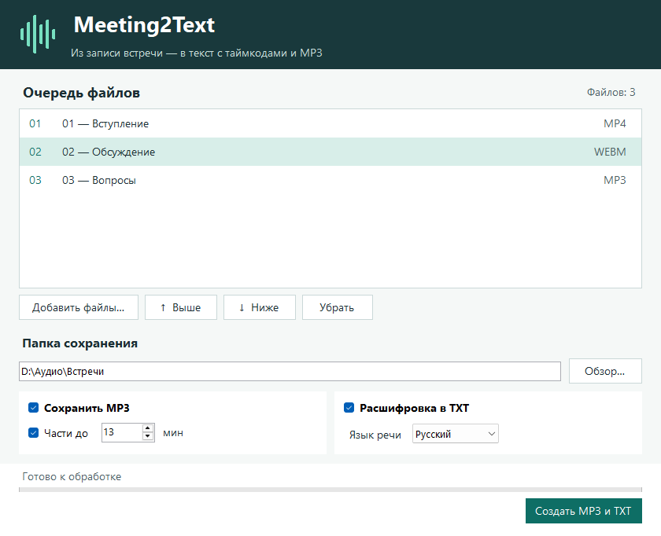

# Meeting2Text

**Из записи встречи — в текст с таймкодами и MP3.** Перетащите видео в Meeting2Text, чтобы найти нужную фразу в тексте или послушать разговор по дороге. Несколько записей можно объединить, а длинный разговор — разделить на короткие аудиофайлы. Meeting2Text работает на Windows и после установки распознаёт речь прямо на компьютере.

[**Полный установщик для Windows x64**](https://github.com/akiooooo/meeting-2-txt-mp3/releases/latest/download/Meeting2Text-Setup-x64.exe) · [Компактный веб-установщик](https://github.com/akiooooo/meeting-2-txt-mp3/releases/latest/download/Meeting2Text-WebSetup-x64.exe) · [Все версии](https://github.com/akiooooo/meeting-2-txt-mp3/releases)



## Запуск

Запустите **Meeting2Text-Setup-x64.exe**. Установщик добавит приложение в меню «Пуск» и откроет его. FFmpeg и обе модели распознавания уже внутри. Права администратора и подключение к интернету при установке не требуются.

Веб-установщик скачивает тот же полный пакет с GitHub и проверяет SHA-256 перед запуском. Для установки без интернета используйте полный EXE.

## Обработка записей

Перетащите MP4, WebM, MKV, MOV, MP3 или другие медиафайлы в окно. Расставьте их кнопками **Выше** и **Ниже**, укажите папку и выберите результат.

| Опция | Что появится в папке |
| --- | --- |
| **Сохранить MP3** | Один файл, стерео, 48 кГц, 192 кбит/с. |
| **Части до … мин** | Полный MP3 и папка с пронумерованными фрагментами. По умолчанию предел составляет 13 минут. |
| **Расшифровка в TXT** | Текст с отметками вида `[00:04:12]` от начала общей записи. Можно сохранить отдельно или вместе с MP3. |

Для одного входного файла сохраняется его имя. Для нескольких используется имя «Общее аудио». При совпадении имён программа добавляет суффикс `(2)`, `(3)` и далее. Расшифровка использует первую аудиодорожку каждого файла. Язык по умолчанию — русский, также доступны английский и автоопределение.

**С клавиатуры** · `Ctrl+O` открывает выбор файлов. В очереди `Ctrl+A` выделяет всё, `Alt+↑` и `Alt+↓` перемещают выделение, `Delete` убирает его из списка.

## Протокол встречи в формате MN

Добавьте запись или один готовый TXT в кодировке UTF-8. Включите **Протокол MN**, укажите дату встречи и нажмите **Создать протокол**. Для готового текста повторное распознавание не требуется. Для записи можно одновременно сохранить MP3, полную расшифровку и протокол.

В выбранной папке появится файл `<имя>.mn.txt`. Он начинается с `#MN` и даты, затем идут темы в разделе **Обсуждали:** и нумерованные договорённости в **Решили:**. Если модель не нашла подтверждённых решений, в протоколе будет соответствующая пометка. Перед отправкой участникам проверьте формулировки, имена и сроки по расшифровке.

При первом использовании приложение предложит скачать движок llama.cpp и модель [Qwen3-4B-Instruct-2507](https://huggingface.co/unsloth/Qwen3-4B-Instruct-2507-GGUF) — вместе около 2,53 ГБ. При прерывании загрузки модели завершённые фрагменты сохраняются до следующего запуска. Компоненты хранятся в `%LOCALAPPDATA%\Meeting2Text\MN-v1`. После загрузки текст обрабатывается локально на CPU. MP3 и расшифровка работают без этого модуля.

## Сборка из исходников

На Windows x64 с .NET Framework 4.8 выполните в корне репозитория:

```bat
build.cmd
```

Результат — `Meeting2Text.exe` рядом со скриптом. Сборка использует системный компилятор C# и Windows Forms. Для запуска из исходников установите FFmpeg с фильтром whisper и выполните `powershell -ExecutionPolicy Bypass -File .\scripts\Get-Models.ps1`. Для сборки установщика укажите путь к bin полной shared-сборки Gyan FFmpeg в переменной FFMPEG_BIN и скомпилируйте scripts/Meeting2Text.iss в Inno Setup 6.

Распознавание использует [Whisper small](https://huggingface.co/ggerganov/whisper.cpp) и [Silero VAD](https://huggingface.co/ggml-org/whisper-vad) через фильтр [FFmpeg whisper](https://ffmpeg.org/ffmpeg-filters.html#whisper). Лицензии моделей находятся в каталоге `models`.
